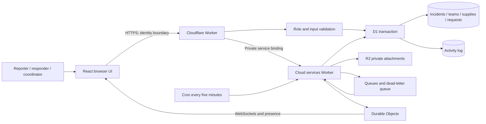

# Relief Desk

A disaster emergency and relief coordination system for a cloud computing course. Built with React, TypeScript, Vinext, Cloudflare Workers, and Cloudflare D1 (SQLite).

## Workflows

- Report incidents with disaster type, severity, affected population, location, and optional coordinates.
- Automatically assign new located incidents to the nearest free, on-duty team; retry waiting reports every minute.
- Triage incidents and assign response teams. Track reported → responding → contained → resolved.
- Register relief supplies and stock locations; restock inventory.
- Request supplies for active incidents, dispatch atomically, or cancel requests.
- Coordinate across browsers with Durable Object WebSocket live updates, reconnect handling, and a shared activity log.
- Control actions with reporter, responder, and coordinator roles.
- Export the current workspace as JSON.
- Attach private JPG, PNG, or PDF evidence to incidents using R2 (5 MB/file, 20 files/incident, 500 MB/workspace).
- Review queued critical-incident and dispatch notifications in Alerts.
- Run automatic five-minute checks for unassigned critical incidents, overdue requests, and low stock.

This is a learning environment, not an operational emergency dispatch service. Reports are entered by users; there is no official disaster-feed integration.

## Run locally

Requires Node.js 22.13+ (Node 24 recommended).

```sh
npm ci
npm run build
node --import ./scripts/sites-env.mjs ./node_modules/wrangler/bin/wrangler.js d1 execute DB --local --config dist/server/wrangler.json --persist-to .wrangler/state --file drizzle/0000_goofy_nightcrawler.sql
node --import ./scripts/sites-env.mjs ./node_modules/wrangler/bin/wrangler.js d1 execute DB --local --config dist/server/wrangler.json --persist-to .wrangler/state --file drizzle/0001_coordination_guards.sql
node --import ./scripts/sites-env.mjs ./node_modules/wrangler/bin/wrangler.js d1 execute DB --local --config dist/server/wrangler.json --persist-to .wrangler/state --file drizzle/0002_request_receipts.sql
node --import ./scripts/sites-env.mjs ./node_modules/wrangler/bin/wrangler.js d1 execute DB --local --config dist/server/wrangler.json --persist-to .wrangler/state --file drizzle/0003_preserve_coordinator.sql
node --import ./scripts/sites-env.mjs ./node_modules/wrangler/bin/wrangler.js d1 execute DB --local --config dist/server/wrangler.json --persist-to .wrangler/state --file drizzle/0004_cloud_services.sql
node --import ./scripts/sites-env.mjs ./node_modules/wrangler/bin/wrangler.js d1 execute DB --local --config dist/server/wrangler.json --persist-to .wrangler/state --file drizzle/0005_cloud_outbox_trigger.sql
node --import ./scripts/sites-env.mjs ./node_modules/wrangler/bin/wrangler.js d1 execute DB --local --config dist/server/wrangler.json --persist-to .wrangler/state --file drizzle/0006_automatic_assignment.sql
node --import ./scripts/sites-env.mjs ./node_modules/wrangler/bin/wrangler.js d1 execute DB --local --config dist/server/wrangler.json --persist-to .wrangler/state --file drizzle/0007_assignment_guards.sql
npm run dev -- --host 127.0.0.1 --port 5193
```

Open http://127.0.0.1:5193 and select Sign in. Development uses the starter's localhost-only mock sign-in. It strips forged identity headers. The first authenticated member becomes coordinator; subsequent members are reporters until promoted by a coordinator. Local mock identity is not a production authentication system.

Migrations above apply once to a new local database. Do not replay them against an already initialized database. Keep `.wrangler` out of version control.

## Verify

With the dev server running on port 5193:

```sh
npx tsc --noEmit
npm test
npx playwright install chromium
npx playwright test
npm run build
```

Browser tests create identifiable test records in the local database. They must not target a production workspace.

## Architecture



`app/api/state` returns a consistent database batch snapshot. `app/api/action` validates JSON, checks the same-origin policy and the authenticated role, then commits the action and audit event in a D1 batch. Parameterized queries prevent SQL injection. React text rendering escapes report content.

Optimistic version checks protect incident and inventory updates. SQL triggers enforce sufficient stock at dispatch time, update inventory in the same transaction, and block resolution while requests are pending. Retrying a dispatch cannot consume inventory twice. Browser mutations carry idempotency keys. A retry of the same operation returns its saved result; a reused key with different data is rejected.

## Cloud hosting

The Sites integration provisions a private Worker and D1 database and applies tracked Drizzle migrations. Production identity comes from the Sites authentication boundary; do not expose this Worker directly on an unprotected origin or trust arbitrary identity headers.

A standalone Cloudflare Free deployment target is included; see [deployment instructions](deploy/README.md). It requires your account and Access configuration. Cloudflare Workers Free and D1 Free have quotas; using a free plan does not mean unlimited capacity. Official references:

- https://developers.cloudflare.com/workers/platform/pricing/
- https://developers.cloudflare.com/d1/platform/pricing/

Live updates use hibernating Durable Object WebSockets with five-minute authentication renewal. Full-state fallback refreshes run every 30 seconds; hidden tabs pause connections. Deployments without the cloud binding retain SSE fallback. This implementation is intended for a small demonstration team.

The private `relief-desk-cloud` Worker owns queue consumers, scheduled checks, R2 access, and room objects. SQL activity triggers record an outbox entry in the same transaction as the action; queue processing is idempotent. Unprocessed entries are retried by the scheduled scan. Notifications are in-app only. Responders and coordinators can acknowledge alerts; coordinators can run checks manually. Uploaders and coordinators can delete attachments; authenticated members can download them.

## Project structure

- `app/page.tsx`: responsive dashboard and operational forms.
- `app/globals.css`: visual system and responsive layouts.
- `app/api/`: authenticated read and write APIs.
- `lib/validation.ts`: input schemas and allowed transitions.
- `lib/server.ts`: identity, database access, and error handling.
- `db/schema.ts`, `drizzle/`: schema and ordered SQL migrations.
- `tests/`: database invariants and browser/API workflow tests.

## Verification

The expanded Cloudflare deployment passed type checking, the production build, 17 database/security tests, and seven browser tests locally. These cover queue duplication/retry, scheduled alert rules, attachment validation and permissions, inventory concurrency, stale edits, origin protection, authentication, mobile layout, and live reconnects. The main app and private cloud Worker were deployed on 23 October 2026; public unauthenticated requests redirect to Cloudflare Access. Authenticated production workflows should also be checked from a signed-in browser.

In the live app, open an incident to attach a file, open Alerts to review notifications or run Check now as coordinator, and open a second browser to see presence. The scheduled scanner records its last run in Alerts. No finite test suite can prove every possible edge case or zero defects.

## Automatic nearest-team assignment

In Response teams, a coordinator selects **Update location / availability**, enters the team's actual latitude and longitude, and marks it available. Existing teams retain their location names and start with empty coordinates; the app does not guess coordinates from a place name. Browser geolocation is optional and requires an explicit button click and browser permission.

New incident reports attempt assignment immediately after their durable save. The dispatcher uses Haversine great-circle (straight-line) distance, skips off-duty teams and teams attached to any unresolved incident, and breaks equal-distance ties by team ID. Assignment leaves status as Reported: a responder still confirms Responding. The assignment, distance, timestamp, activity event, and notification commit together. Database guards prevent manual and automatic claims from double-booking a team; version checks preserve concurrent manual decisions.

A one-minute Cron retries up to 25 waiting reports per tick; successful app mutations also trigger retries, including when an incident resolves or a team becomes available. Checked rows rotate through the backlog. Escalation checks still run every five minutes. The under-one-minute target is met by the immediate path when coordinates and a free team exist; it is not a hard deadline during outages, quota exhaustion, or large backlogs. This is not road routing or predicted arrival time.

Missing coordinates and exhausted team capacity appear explicitly in incident details. A responder/coordinator can choose **Set coordinates & auto-assign** for an unassigned report, including a legacy incident. Existing assignments and legacy incidents stay manual after migration. Unchecking automatic assignment in Coordinate response preserves intentional manual handling. Resolving an incident releases its team's capacity. Marking a busy team off duty does not silently remove its current assignment.

Expired Access redirects are detected during state refresh, live reconnections pause, and the app offers **Sign in again**. Network failures instead offer connection/retry guidance while preserving previously loaded data.
