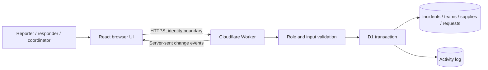

# Relief Desk

A disaster emergency and relief coordination system for a cloud computing course. Built with React, TypeScript, Vinext, Cloudflare Workers, and Cloudflare D1 (SQLite).

## Workflows

- Report incidents with disaster type, severity, affected population, location, and optional coordinates.
- Triage incidents and assign response teams. Track reported → responding → contained → resolved.
- Register relief supplies and stock locations; restock inventory.
- Request supplies for active incidents, dispatch atomically, or cancel requests.
- Coordinate across browsers with server-sent live updates, reconnect handling, and a shared activity log.
- Control actions with reporter, responder, and coordinator roles.
- Export the current workspace as JSON.

This is a learning environment, not an operational emergency dispatch service. Reports are entered by users; there is no official disaster-feed integration.

## Run locally

Requires Node.js 22.13+ (Node 24 recommended).

```sh
npm ci
npm run build
node --import ./scripts/sites-env.mjs ./node_modules/wrangler/bin/wrangler.js d1 execute DB --local --config dist/server/wrangler.json --persist-to .wrangler/state --file drizzle/0000_goofy_nightcrawler.sql
node --import ./scripts/sites-env.mjs ./node_modules/wrangler/bin/wrangler.js d1 execute DB --local --config dist/server/wrangler.json --persist-to .wrangler/state --file drizzle/0001_coordination_guards.sql
node --import ./scripts/sites-env.mjs ./node_modules/wrangler/bin/wrangler.js d1 execute DB --local --config dist/server/wrangler.json --persist-to .wrangler/state --file drizzle/0002_request_receipts.sql
node --import ./scripts/sites-env.mjs ./node_modules/wrangler/bin/wrangler.js d1 execute DB --local --config dist/server/wrangler.json --persist-to .wrangler/state --file drizzle/0003_preserve_coordinator.sql
npm run dev -- --host 127.0.0.1 --port 5193
```

Open http://127.0.0.1:5193 and select Sign in. Development uses the starter's localhost-only mock sign-in. It strips forged identity headers. The first authenticated member becomes coordinator; subsequent members are reporters until promoted by a coordinator. Local mock identity is not a production authentication system.

Migrations above apply once to a new local database. Do not replay them against an already initialized database. Keep `.wrangler` out of version control.

## Verify

With the dev server running on port 5193:

```sh
npx tsc --noEmit
npm test
npx playwright install chromium
npx playwright test
npm run build
```

Browser tests create identifiable test records in the local database. They must not target a production workspace.

## Architecture



`app/api/state` returns a consistent database batch snapshot. `app/api/action` validates JSON, checks the same-origin policy and the authenticated role, then commits the action and audit event in a D1 batch. Parameterized queries prevent SQL injection. React text rendering escapes report content.

Optimistic version checks protect incident and inventory updates. SQL triggers enforce sufficient stock at dispatch time, update inventory in the same transaction, and block resolution while requests are pending. Retrying a dispatch cannot consume inventory twice. Browser mutations carry idempotency keys. A retry of the same operation returns its saved result; a reused key with different data is rejected.

## Cloud hosting

The Sites integration provisions a private Worker and D1 database and applies tracked Drizzle migrations. Production identity comes from the Sites authentication boundary; do not expose this Worker directly on an unprotected origin or trust arbitrary identity headers.

A standalone Cloudflare Free deployment target is included; see [deployment instructions](deploy/README.md). It requires your account and Access configuration. Cloudflare Workers Free and D1 Free have quotas; using a free plan does not mean unlimited capacity. Official references:

- https://developers.cloudflare.com/workers/platform/pricing/
- https://developers.cloudflare.com/d1/platform/pricing/

D1 Free currently includes 5 million rows read/day, 100,000 rows written/day, and 5 GB total storage. Refresh traffic must remain within Worker request limits. Live streams check the indexed activity revision once per second and reconnect every 25 seconds. Full-state fallback refreshes run every 30 seconds. Hidden tabs pause both. This implementation is intended for a small demonstration team.

## Project structure

- `app/page.tsx`: responsive dashboard and operational forms.
- `app/globals.css`: visual system and responsive layouts.
- `app/api/`: authenticated read and write APIs.
- `lib/validation.ts`: input schemas and allowed transitions.
- `lib/server.ts`: identity, database access, and error handling.
- `db/schema.ts`, `drizzle/`: schema and ordered SQL migrations.
- `tests/`: database invariants and browser/API workflow tests.

## Remaining verification

Track live deployment and standalone free-tier verification before treating the project as submission-ready. Database and browser tests cover concurrency, stale edits, invalid input, injection, origin protection, authentication, duplicate retries, mobile overflow, live updates between browsers, and reconnect behavior. No finite test suite can prove every possible edge case or zero defects.
